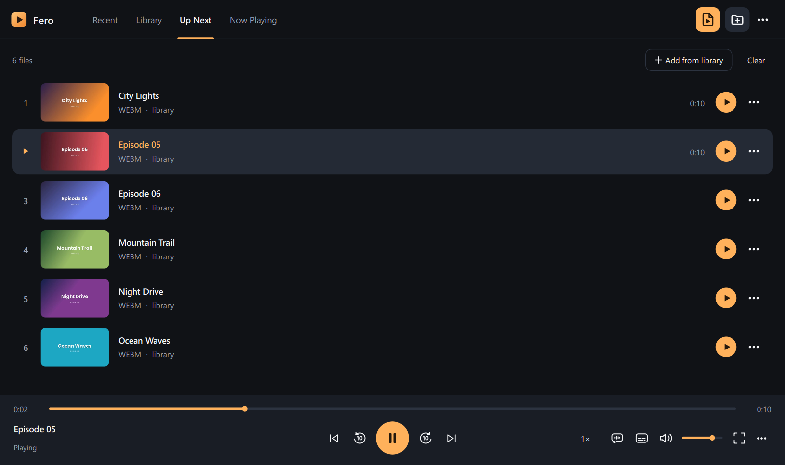

# Fero Player

A fast, clean video and music player for Windows, built on [mpv](https://mpv.io) and Qt.
It opens almost any file, starts playback in a fraction of a second and keeps the picture
quality of the best players, in a simple interface made for watching films and series.

## Features

- **Plays almost everything.** All FFmpeg 9 decoders and formats: MKV, MP4, AVI, HEVC/H.265,
  AV1, VP9, 10-bit and HDR video, DTS, TrueHD, FLAC, ASS/SRT/PGS subtitles and many more.
- **Fast.** The window appears in about 0.15 s, the first frame of a file usually in under
  0.1 s. The video output and the audio device are prepared in advance, so resuming an episode
  does not wait for the GPU or for a sleeping sound card.
- **High picture quality.** mpv's libplacebo renderer (`gpu-next`) on Direct3D 11 with
  hardware decoding, high-quality scaling, debanding and tone mapping of HDR to SDR screens.
- **Made for series.** The rest of the folder plays automatically as *Up Next*, every file
  remembers where you stopped, and the dub and subtitles you pick carry over to the next
  episodes of the same folder.
- **Library and Recent** as tiles with previews, search and resume progress.
- **Skip intro, recap and credits** buttons when a file has chapters with such names.
- **Light on resources.** About 105 MB of memory while playing; one portable folder, nothing
  else to install.
- **English and Russian** interface.

## Keyboard

| Key | Action |
|---|---|
| Space | Play / pause |
| ← / → | Back / forward 10 s (Shift: 1 min) |
| ↑ / ↓ | Volume |
| M | Mute |
| A | Next audio track; **A1…A9** pick a track by number |
| S | Next subtitles (including off); **S1…S9** by number, **S0** off |
| F, F11, double-click | Full screen; Esc leaves it |
| Ctrl+← / Ctrl+→ | Previous / next file |
| E | Next frame |
| Ctrl+S | Save the current frame |
| Ctrl+O / Ctrl+Shift+O | Open files / add a folder to the library |

Letter keys work in any keyboard layout.

## Download

Get the latest release from the [Releases](../../releases) page:

- `FeroPlayer-Setup-x.y.z.exe` – installer. Adds Fero Player to *Open with* and to
  *Settings → Apps → Default apps*, where you can make it the default player. No administrator
  rights are needed.
- `FeroPlayer-x.y.z-portable-x64.zip` – unpack anywhere and run `FeroPlayer.exe`.

Requirements: Windows 10 or 11 (64-bit), a GPU with Direct3D 11, and a CPU with AVX2
(Intel Haswell / AMD Ryzen or newer – the engine is built for x86-64-v3).

Settings, the library and resume points are stored in `%LOCALAPPDATA%\FeroPlayer`.

## Building from source

Everything is built with MinGW from command files in this folder:

1. `Setup.cmd` – downloads the compiler, Qt 6.8.3 and a ready-made libmpv into `.deps`
   (one time, about 1.5 GB).
2. `Build.cmd` – compiles, packages `dist\FeroPlayer` and runs a short self-test.
3. `Release.cmd` – the same plus the portable ZIP and the installer
   ([Inno Setup](https://jrsoftware.org/isinfo.php) is installed automatically).

The release builds additionally link Qt statically and use a custom libmpv
(FFmpeg 9 + mpv, optimised for x86-64-v3, without network and disc playback).
They are built once by `tools\build-qt-static.ps1` and `tools\build-mpv.ps1`; put the words
`qtstatic mpv` into `tools\rebuild-request.txt` before running `Build.cmd` to make them.
This takes one to two hours.

## License

Fero Player is free software under the [GNU General Public License v3.0 or later](LICENSE).
It includes mpv, FFmpeg, Qt and other libraries; see
[THIRD-PARTY-NOTICES.md](THIRD-PARTY-NOTICES.md).

---

## По-русски

Fero Player — быстрый видео- и аудиоплеер для Windows на движке mpv. Открывает почти любые
форматы, запускает видео за доли секунды и показывает картинку с максимальным качеством.

- Серии из папки идут подряд, плеер помнит место остановки, а выбранная озвучка и субтитры
  переходят на следующие серии.
- Медиатека и «Недавние» в виде плиток с превью.
- Горячие клавиши: A / A1…A9 — озвучка, S / S1…S9 / S0 — субтитры, ↑ ↓ — громкость.
- Интерфейс на русском и английском.

Скачать: страница [Releases](../../releases) — установщик или портативная версия (ZIP).
